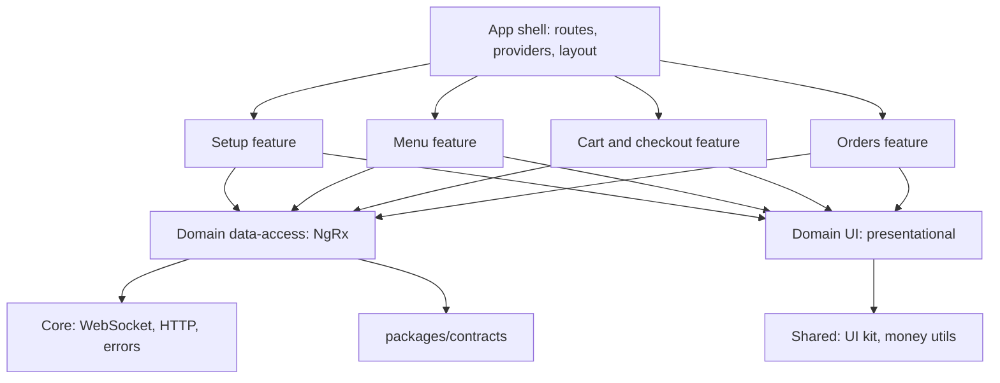

# Restaurant Ordering: real-time prototype

A prototype of a restaurant ordering web app: menu configuration (Setup), ordering (Menu)
and a minimal server with real-time updates. Built with Angular, NgRx and Fastify.

## How to run

Requirements: Node.js 22 LTS (22.22.3 or newer, required by Angular CLI 22) or Node.js 24 LTS,
npm 11.21 or newer (older npm 11 releases drop platform-specific build tool binaries from
`package-lock.json`; update with `npm install -g npm@latest`).

```bash
npm install
npm start
```

- Web: http://localhost:4200
- API: http://localhost:3000 (proxied from the web app under `/api`, including the WebSocket at `/api/ws`)

Other commands:

```bash
npm test        # unit tests for web and server, type check of contracts
npm run lint    # lint, including architecture boundaries
npm run build   # production build of web and server
```

Server environment variables (all optional):

| Variable | Default | Purpose |
|---|---|---|
| `PORT` | `3000` | Server port |
| `LATENCY_MS` | `0` | Artificial latency for REST responses (not `/api/ws` or `/api/health`) |
| `FAILURE_RATE` | `0` | Share of REST requests (0..1) that fail with 500 `INTERNAL`, for testing error handling. See below |
| `STATUS_STEP_MS` | `8000` | Interval between simulated order status changes, with ±30% jitter |
| `EVENT_BUFFER_SIZE` | `1000` | Events kept for resume after reconnect |
| `HEARTBEAT_MS` | `10000` | Server ping interval |
| `WS_DROP_MS` | unset | If set, drops every socket at this interval to demonstrate reconnect |

`FAILURE_RATE` never affects `/api/ws` or `/api/health`. A failing GET fails before it runs.
For a failing mutation (POST, PATCH, DELETE), half the failures happen before the change and
half **after** it: the change is applied and its event is broadcast, but the response is
replaced with a 500. This simulates a response lost on the way back. Clients must therefore
treat a 500 on a mutation as "outcome unknown": checkout retries with the same
`Idempotency-Key` and gets the original order back with 200, and the menu converges through
the event stream.

## Architecture

```
apps/web/            Angular app
apps/server/         Fastify server, in-memory data
packages/contracts/  Shared types: DTOs, events, errors, API paths
```

### Frontend layers



Each domain (`menu`, `setup`, `cart`, `orders`) has `data-access`, `feature-*` and `ui` folders.
Dependencies only point downwards; features never import other features. The rules are enforced by
`eslint-plugin-boundaries`, so breaking them fails `npm run lint`:

- `feature-*`: its own domain's `data-access` and `ui`, other domains only through their public
  `index.ts` (`@menu`, `@cart`, ...), `core`, `shared`.
- `data-access`: `core`, `shared/util`, contracts, and other domains' public `index.ts`
  (the cart reads menu items for live prices and availability).
- `ui` and `shared/ui`: presentational only; no NgRx, contracts as types only.
- `core` never imports domains; `shared` never imports `core` or domains.

### Data flow

Commands go over REST. Every state change comes back to all clients over a single WebSocket.
The transport is isolated in `core/realtime`; domains only see typed `ServerEvent`s. The menu store is updated only from snapshots and events, never from HTTP mutation responses,
so there is one source of truth regardless of which tab made the change.

## Key decisions and trade-offs

### State management: classic NgRx Store

NgRx Store + Effects + Entity. Server events map naturally to actions, the event flow is visible in
Redux DevTools, reducers and selectors are pure and easy to test, and it matches what the team uses.
Rejected: NgRx SignalStore (less code and slightly lighter, but the event flow is less transparent) and
NGXS (smaller community, no benefit here). The performance gap to SignalStore is closed by running
zoneless and reading state with `selectSignal`.

Global store holds only shared, server-synchronized state: menu, cart, connection, orders.
Form state, dialogs and checkout steps are local component state. Containers use the store directly;
no facades, to avoid a layer that would only proxy calls in a project of this size.

### Real-time transport: WebSocket for events, REST for commands

Events go over a plain WebSocket with a small typed protocol (`packages/contracts/src/realtime.ts`):
`hello { lastSeq }` → `welcome` → replay or `resync_required` → live events, with `ping`/`pong` heartbeat.

- **Plain WebSocket, no socket.io.** Reconnect, heartbeat and resume are the parts that decide whether
  live data can be trusted, so they are explicit, small and tested, not hidden in a library with its own protocol.
- **Reconnect** uses exponential backoff with full jitter (to avoid a reconnect storm after a server restart),
  and reconnects immediately on the browser `online` event and when a hidden tab becomes visible.
- **Heartbeat** detects half-open connections, common on mobile networks, where the socket looks open
  but nothing arrives. Without it a user could look at stale prices for minutes.
- **Resume** sends the last seen `seq` in `hello`, so a short disconnect replays only missed events
  instead of reloading everything.
- **Commands stay on REST.** Status codes, `409` conflicts, idempotency headers, retries and tests are
  simpler over HTTP than request/response correlation over a socket.

Rejected: Server-Sent Events. They would be enough here (one-directional, automatic reconnect,
`Last-Event-ID` resume built in), but WebSocket matches the team's stack and gives full control over
liveness detection. Also rejected: socket.io (extra protocol and bundle weight, hides the behaviour above).

### Event model: global sequence and versioned full upserts

- Every event has a global, strictly increasing `seq`.
- Snapshots carry the `seq` they reflect. While a snapshot loads, its domain buffers incoming events and then
  applies only those with `seq >` snapshot `seq`, so nothing is lost or applied twice regardless of timing.
  The same flow serves the initial load, resync, and the lazy orders feature.
- If a client reconnects after the server's event buffer has moved on, the server sends
  `resync_required` and the client refetches snapshots.
- Upsert events carry the full entity, applied only if its `version` is newer. This is idempotent and
  tolerant to duplicates. Rejected: field-level deltas (smaller payloads, but entities are small and
  deltas make reducers order-sensitive).
- Stream events are buffered for about one animation frame and applied as one action, so a burst
  (for example, a whole category disabled) costs one reducer pass and one render.

### Checkout: no double orders, no surprises

- An `Idempotency-Key` is created when checkout starts and changes only when the cart contents change.
  The server returns the original order for a repeated key and rejects a reused key with a different body.
- The submit effect uses `exhaustMap` and the button is disabled while pending.
- Each cart line sends the price and item version the user saw. If anything changed, the server answers
  `409 MENU_CHANGED` with the list of changes and fresh items; the client updates the menu, shows the
  changes and lets the user confirm. Cart lines also show issues live, before checkout is pressed.
- Totals are computed on the server; the fixed discount is clamped to the subtotal.
- Order lines store a snapshot of name and price, so later menu edits do not rewrite order history.

### Pricing and money

- All amounts are integers in minor units; floats are never used for money.
- `Pricing` is a discriminated union: `fixed` with a price, or `open` with `min`/`max`. The compiler
  forces both cases to be handled. Open price is entered in a dialog when adding to the cart and
  validated against the item's limits on both client and server.

### Setup: optimistic concurrency

Every mutation sends `expectedVersion`. If the entity changed meanwhile, the server returns
`409 VERSION_CONFLICT` with current values, so two admins never silently overwrite each other;
the form is refreshed with the latest version and the user is told why.
Rows show a pending state until the resulting event arrives.

### Performance

- Zoneless change detection, `OnPush` everywhere, signal inputs; a live update re-renders only the affected row.
- Every route is lazy; `@defer` for non-critical parts.
- CDK virtual scroll for the menu (about 3000 seeded items) with fixed row height; live updates never change row size.
- Skeletons match real content dimensions to avoid layout shift.
- Unavailable items stay in place, disabled, instead of disappearing under the cursor.

### Reliability

- All errors follow one `ApiError` shape with a user-safe `message`.
- The connection state is shown in a non-blocking banner. While offline the app keeps working with
  the last known data and disables checkout.
- If the server rejects the socket protocol (close code `4400`), the client does not retry in a loop;
  it shows an error state with a reload action instead.
- HTTP requests time out after 15 s; network errors, timeouts and unexpected responses are all
  turned into the same `ApiError` shape with a user-safe message.
- Failed requests can be retried; a retried checkout reuses its idempotency key.
- The server can inject latency, failures and socket drops (`LATENCY_MS`, `FAILURE_RATE`, `WS_DROP_MS`)
  to demonstrate this.

### Project setup

- npm workspaces instead of Nx: two apps and one shared package do not justify Nx's tooling weight.
  Boundaries are still enforced through ESLint.
- Fastify with `@fastify/websocket` and in-memory data: minimal, fast, typed. Rejected: NestJS (too heavy for a minimal server).
- Contracts are consumed as TypeScript sources (no separate build step). The server runs with `tsx` in
  development and is bundled with `tsup` for production, so the contracts are inlined into `dist/main.js`.
  Rejected: building contracts to JavaScript with project references (an extra build step and watch process).
- Contracts are plain TypeScript types shared by both apps. Rejected for now: TypeBox or zod schemas, which
  would add runtime validation from the same source at the cost of an extra dependency.

## Deliberate simplifications

- No authentication or roles; Setup is open to everyone.
- No database; data lives in memory and resets on restart. Seed data is deterministic.
- One currency (UAH), no taxes, service fees or tips.
- Order statuses are simulated by a server timer; there is no kitchen UI.
- All clients see all orders; there is no notion of a customer.
- The event buffer lives in memory of a single server instance.
- Every client receives every event; there are no per-topic subscriptions (the menu and orders are small enough).
- The socket is not authenticated.
- No runtime validation of incoming events on the client; the contract is trusted at compile time.
- _TBD: extend during implementation._

## Production readiness

What would be needed:

- Persistent storage (for example PostgreSQL) with transactions around order creation, and a durable
  idempotency key store with expiry.
- Authentication, authorization for Setup, per-customer order visibility.
- Horizontal scaling of WebSockets: a shared event log and pub/sub (Redis Streams, Postgres LISTEN/NOTIFY,
  or a message broker) so any instance can replay and broadcast; load balancer with WebSocket support and
  connection draining on deploys.
- Socket authentication (token in `hello` or a short-lived ticket), per-topic subscriptions, rate limiting
  and message size limits, backpressure handling for slow clients.
- Runtime validation of all inputs and events from shared schemas.
- Payments integration, taxes, multi-currency, and audit logging of menu and price changes.
- Observability: structured logs, metrics, tracing, error reporting on the client.
- E2E tests (Playwright) for checkout and real-time scenarios, load tests for the event stream.
- Images with responsive sizes and a CDN, HTTP caching for snapshots, service worker for offline shell.
- CI pipeline with build, lint, tests and bundle-size checks.
- Accessibility audit and internationalization.
- _TBD: extend during implementation._
