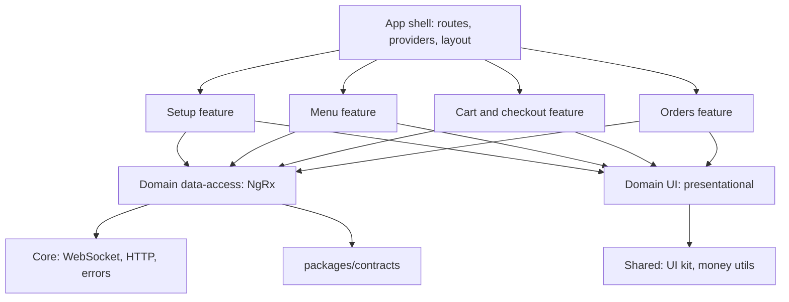

# Restaurant Ordering: real-time prototype

A prototype of a restaurant ordering web app: menu configuration (Setup), ordering (Menu)
and a minimal server with real-time updates. Built with Angular, NgRx and Fastify.

## How to run

Requirements: Node.js 22 LTS (22.22.3 or newer, required by Angular CLI 22) or Node.js 24 LTS,
npm 11.21 or newer (older npm 11 releases drop platform-specific build tool binaries from
`package-lock.json`; update with `npm install -g npm@latest`).

```bash
npm ci
npm start
```

`npm ci` installs exactly what `package-lock.json` lists; `npm install` also works with a recent npm.

- Web: http://localhost:4200
- API: http://localhost:3000 (proxied from the web app under `/api`, including the WebSocket at `/api/ws`)

Other commands:

```bash
npm test        # unit tests for web and server, type check of contracts
npm run lint    # lint, including architecture boundaries
npm run build   # production build of web and server
```

Server environment variables (all optional):

| Variable | Default | Purpose |
|---|---|---|
| `PORT` | `3000` | Server port |
| `LATENCY_MS` | `0` | Artificial latency for REST responses (not `/api/ws` or `/api/health`) |
| `FAILURE_RATE` | `0` | Share of REST requests (0..1) that fail with 500 `INTERNAL`, for testing error handling. See below |
| `STATUS_STEP_MS` | `8000` | Interval between simulated order status changes, with ±30% jitter |
| `EVENT_BUFFER_SIZE` | `1000` | Events kept for resume after reconnect |
| `HEARTBEAT_MS` | `10000` | Server ping interval |
| `WS_DROP_MS` | unset | If set, drops every socket at this interval to demonstrate reconnect |
| `LOG_LEVEL` | `info` | Server log level (`fatal`, `error`, `warn`, `info`, `debug`, `trace`, `silent`) |

`FAILURE_RATE` never affects `/api/ws` or `/api/health`. A failing GET fails before it runs.
For a failing mutation (POST, PATCH, DELETE), half the failures happen before the change and
half **after** it: the change is applied and its event is broadcast, but the response is
replaced with a 500. This simulates a response lost on the way back. Clients must therefore
treat a 500 on a mutation as "outcome unknown": checkout retries with the same
`Idempotency-Key` and gets the original order back with 200, and the menu converges through
the event stream.

## Architecture

```
apps/web/            Angular app
apps/server/         Fastify server, in-memory data
packages/contracts/  Shared types: DTOs, events, errors, API paths
```

### Frontend layers



Each domain (`menu`, `setup`, `cart`, `orders`) has `data-access`, `feature-*` and `ui` folders.
Dependencies only point downwards; features never import other features. The rules are enforced by
`eslint-plugin-boundaries`, so breaking them fails `npm run lint`:

- `feature-*`: its own domain's `data-access` and `ui`, other domains only through their public
  `index.ts` (`@menu`, `@cart`, ...), `core`, `shared`.
- `data-access`: `core`, `shared/util`, contracts, and other domains' public `index.ts`
  (the cart reads menu items for live prices and availability).
- `ui` and `shared/ui`: presentational only; no NgRx, contracts as types only.
- `core` never imports domains; `shared` never imports `core` or domains.

### Data flow

Commands go over REST. Every state change comes back to all clients over a single WebSocket.
The transport is isolated in `core/realtime`; domains only see typed `ServerEvent`s. The menu store is updated only from snapshots and events, never from HTTP mutation responses,
so there is one source of truth regardless of which tab made the change.

## Key decisions and trade-offs

### State management: classic NgRx Store

NgRx Store + Effects + Entity. Server events map naturally to actions, the event flow is visible in
Redux DevTools, reducers and selectors are pure and easy to test, and it matches what the team uses.
Rejected: NgRx SignalStore (less code and slightly lighter, but the event flow is less transparent) and
NGXS (smaller community, no benefit here). The performance gap to SignalStore is closed by running
zoneless and reading state with `selectSignal`.

Global store holds only shared, server-synchronized state: menu, cart, connection, orders.
Form state, dialogs and checkout steps are local component state. Containers use the store directly;
no facades, to avoid a layer that would only proxy calls in a project of this size.

### Real-time transport: WebSocket for events, REST for commands

Events go over a plain WebSocket with a small typed protocol (`packages/contracts/src/realtime.ts`):
`hello { lastSeq }` → `welcome` → replay or `resync_required` → live events, with `ping`/`pong` heartbeat.

- **Plain WebSocket, no socket.io.** Reconnect, heartbeat and resume are the parts that decide whether
  live data can be trusted, so they are explicit, small and tested, not hidden in a library with its own protocol.
- **Reconnect** uses exponential backoff with full jitter (to avoid a reconnect storm after a server restart),
  and reconnects immediately on the browser `online` event and when a hidden tab becomes visible.
- **Heartbeat** detects half-open connections, common on mobile networks, where the socket looks open
  but nothing arrives. Without it a user could look at stale prices for minutes.
- **Resume** sends the last seen `seq` in `hello`, so a short disconnect replays only missed events
  instead of reloading everything.
- **Commands stay on REST.** Status codes, `409` conflicts, idempotency headers, retries and tests are
  simpler over HTTP than request/response correlation over a socket.

Rejected: Server-Sent Events. They would be enough here (one-directional, automatic reconnect,
`Last-Event-ID` resume built in), but WebSocket matches the team's stack and gives full control over
liveness detection. Also rejected: socket.io (extra protocol and bundle weight, hides the behaviour above).

### Event model: global sequence and versioned full upserts

- Every event has a global, strictly increasing `seq`.
- Snapshots carry the `seq` they reflect. While a snapshot loads, its domain buffers incoming events and then
  applies only those with `seq >` snapshot `seq`, so nothing is lost or applied twice regardless of timing.
  The same flow serves the initial load, resync, and the lazy orders feature. The orders state is
  loaded when the page is first opened and stays live after leaving it; an order just placed is shown
  (and highlighted) from the checkout response before its event arrives, with the same version check.
- If a client reconnects after the server's event buffer has moved on, the server sends
  `resync_required` and the client refetches snapshots.
- Upsert events carry the full entity, applied only if its `version` is newer. This is idempotent and
  tolerant to duplicates. Rejected: field-level deltas (smaller payloads, but entities are small and
  deltas make reducers order-sensitive).
- Stream events are buffered for about one animation frame and applied as one action, so a burst
  (for example, a whole category disabled) costs one reducer pass and one render.

### Checkout: no double orders, no surprises

- **Idempotency key lifecycle.** A key belongs to one exact request body. It is created on the first
  submit and cleared whenever anything in the body changes: lines, quantities, unit prices or the
  discount, including the changes the user accepts after a `409`. An unchanged body reuses its key.
  The server returns the original order for a repeated key and rejects a reused key with a different body.
- **Ambiguous failures lock the cart.** After a network error, a timeout or a 5xx the order may already
  exist. The cart is then locked and the only action is Retry, which resends the same body with the
  same key, so it either creates the order once or returns the one already created. Editing requires
  confirming a warning that the previous attempt may have gone through, with a link to the orders;
  the next change then gets a new key. The lock survives a page reload. Definite rejections (4xx)
  do not lock the cart.
- The submit effect uses `exhaustMap` and the button is disabled while pending.
- Each cart line sends the price the user saw (and the item version, for diagnostics). The server
  checks every line by value: item removed, item unavailable, fixed price different from the sent
  price, or open price outside the item's current limits. All changes are collected and returned at
  once as `409 MENU_CHANGED` with the fresh items; the client updates the menu and shows, per line,
  exactly what accepting will do: "price X → Y" or "will be removed" with the reason. Nothing is
  dropped without that confirmation. The same review opens before submitting if cart lines already
  show issues live.
- **Value-based, not version-based.** Any edit bumps an item's version, including a typo fix in its
  name or description. Rejecting on version mismatch would block checkout for changes that do not
  affect what the customer pays or whether the item can be served. Comparing values catches exactly
  the changes that matter, including a switch between fixed and open pricing.
- Totals are computed on the server; the fixed discount is clamped to the subtotal.
- Order lines store a snapshot of name and price, so later menu edits do not rewrite order history.

### Pricing and money

- All amounts are integers in cents; floats are never used for money. They are converted only for
  display, with `Intl.NumberFormat` as USD in en-US format (`1250` → `$12.50`). Money inputs accept `.`
  as the decimal separator and at most two decimals, and are converted to cents by the money utils.
- `Pricing` is a discriminated union: `fixed` with a price, or `open` with `min`/`max`. The compiler
  forces both cases to be handled. Open price is entered in a dialog when adding to the cart and
  validated against the item's limits on both client and server.

### Setup: optimistic concurrency

Every update sends `expectedVersion`. If the entity changed meanwhile, the server returns
`409 VERSION_CONFLICT` with current values, so two admins never silently overwrite each other;
the form is refreshed with the latest version and the user is told why.
Rows show a pending state until the resulting event arrives.
Deleting a category that still has items is refused with `409 CATEGORY_NOT_EMPTY`.

- **One source of truth.** Setup keeps only mutation status (requests in flight, errors, and the
  version each save is waiting for). The data is read from the menu store, which changes only from
  snapshots and events, never from HTTP responses. A row is pending while its request runs and
  until the menu store holds at least the version the server returned, so the event itself clears
  it. Mutations of the same row are sent one after another; different rows go in parallel.
- **Live edits while a form is open.** The item form remembers the version it was loaded from.
  While the form is untouched, every change arriving live is loaded silently, also after a server restart, when versions start again from 1. Once the user has
  edited it, their edits are kept and a notice "This item was changed elsewhere" offers to load the
  latest version. Saving always sends the loaded version, so saving stale edits ends in a version
  conflict: a snackbar explains it and the form shows the latest version. If the item is deleted
  while open, the panel closes with a message.
- The item form is a side panel driven by the URL (`?item=<id>`, `?item=new&category=<id>`), so it
  can be linked and survives a reload. Escape closes it and returns focus to the row; on narrow
  screens it takes the full width. Deletions go through a confirmation dialog.

### Server validation

Requests are validated by small hand-written parsers; every invalid field is reported at once as
`400 VALIDATION_FAILED` with `details.fields`.

- Names: non-empty after trimming, up to 100 characters; descriptions up to 500.
- Amounts: integers in cents, 0 to 100 000 000 ($1,000,000). Open pricing requires `min <= max` and `max >= 1`.
- Orders: 1 to 200 lines, quantity an integer from 1 to 99, discount an integer `>= 0`
  (clamped to the subtotal), and an `Idempotency-Key` header that is a UUID.
- An item must reference an existing category.

### Performance

- Zoneless change detection, `OnPush` everywhere, signal inputs; a live update re-renders only the affected row.
- Every route is lazy.
- The snack bar and the CDK overlay it needs load on demand (prefetched right after startup). Otherwise
  the bundler would also pull CDK virtual scroll into the initial bundle, because both live in the same module.
- CDK virtual scroll for the menu (about 3000 seeded items) with fixed row height; live updates never change row size.
- Skeletons match real content dimensions to avoid layout shift.
- Unavailable items stay in place, disabled, instead of disappearing under the cursor.

### Reliability

- All errors follow one `ApiError` shape with a user-safe `message`.
- The connection state is shown in a non-blocking banner. While offline the app keeps working with
  the last known data and disables checkout.
- If the server rejects the socket protocol (close code `4400`), the client does not retry in a loop;
  it shows an error state with a reload action instead.
- HTTP requests time out after 15 s; network errors, timeouts and unexpected responses are all
  turned into the same `ApiError` shape with a user-safe message.
- Failed requests can be retried; a retried checkout reuses its idempotency key and the cart stays
  locked until the outcome is known.
- The server can inject latency, failures and socket drops (`LATENCY_MS`, `FAILURE_RATE`, `WS_DROP_MS`)
  to demonstrate this.

### Project setup

- npm workspaces instead of Nx: two apps and one shared package do not justify Nx's tooling weight.
  Boundaries are still enforced through ESLint.
- Fastify with `@fastify/websocket` and in-memory data: minimal, fast, typed. Rejected: NestJS (too heavy for a minimal server).
- Contracts are consumed as TypeScript sources (no separate build step). The server runs with `tsx` in
  development and is bundled with `tsup` for production, so the contracts are inlined into `dist/main.js`.
  Rejected: building contracts to JavaScript with project references (an extra build step and watch process).
- Contracts are plain TypeScript types shared by both apps. Rejected for now: TypeBox or zod schemas, which
  would add runtime validation from the same source at the cost of an extra dependency.

## Deliberate simplifications

- No authentication or roles; Setup is open to everyone.
- No database; data lives in memory and resets on restart. Seed data is deterministic: dishes cost
  $3–$35, open-price items allow from $5–$20 up to at most $100.
- Single currency (USD), no localization of number or currency formats (dates are en-US too);
  no taxes, service fees or tips.
- Order statuses are simulated by a server timer; there is no kitchen UI.
- All clients see all orders; there is no notion of a customer.
- The event buffer lives in memory of a single server instance.
- Every client receives every event; there are no per-topic subscriptions (the menu and orders are small enough).
- The socket is not authenticated.
- No runtime validation of incoming events on the client; the contract is trusted at compile time.
- The `cancelled` order status exists in the contract but is never produced; orders always reach `completed`.
- Completed orders stay in memory for the lifetime of the server; nothing is archived or pruned.
- Idempotency keys are kept in memory without expiry.
- Deletes in Setup have no version check: deleting an entity that someone just edited still succeeds.
- No menu search and no highlight of items that just changed live.
- The cart is saved to `localStorage` per browser; open tabs do not sync their carts with each other.
- Live menu updates are applied once per animation frame; in a hidden tab the browser pauses frames, so
  updates are held in memory and applied when the tab becomes visible again.
- The cart is a separate page (`/cart`) rather than a side panel.
- The orders list is not virtualized: all orders are kept in memory by the server and the list stays
  short in a demo. Each card still re-renders only when its own order changes.
- Setup has no inline price editing; prices are changed in the item form. Availability can be
  toggled inline.
- Items cannot be deleted from Setup; making an item unavailable stops it from being ordered.
- Restarting the server resets data and the event sequence. Clients notice through `resync_required`
  and reload their snapshots; cart lines for items that no longer exist are shown as removed.
- No end-to-end tests. Reconnect, resume, resync and checkout retries are covered by unit tests; the
  server's fault injection (`LATENCY_MS`, `FAILURE_RATE`, `WS_DROP_MS`) is there to try them by hand.

## Production readiness

What would be needed:

- Persistent storage (for example PostgreSQL) with transactions around order creation, and a durable
  idempotency key store with expiry.
- Authentication, authorization for Setup, per-customer order visibility.
- Horizontal scaling of WebSockets: a shared event log and pub/sub (Redis Streams, Postgres LISTEN/NOTIFY,
  or a message broker) so any instance can replay and broadcast; load balancer with WebSocket support and
  connection draining on deploys.
- Socket authentication (token in `hello` or a short-lived ticket), per-topic subscriptions, rate limiting
  and message size limits, backpressure handling for slow clients.
- Runtime validation of all inputs and events from shared schemas.
- Payments integration, taxes, multi-currency, and audit logging of menu and price changes.
- Observability: structured logs, metrics, tracing, error reporting on the client.
- E2E tests (Playwright) for checkout and real-time scenarios, load tests for the event stream.
- Images with responsive sizes and a CDN, HTTP caching for snapshots, service worker for offline shell.
- CI pipeline with build, lint, tests and bundle-size checks.
- Accessibility audit and internationalization.
- A pinned npm version (`packageManager` with Corepack), so every machine resolves the lockfile the same way.
